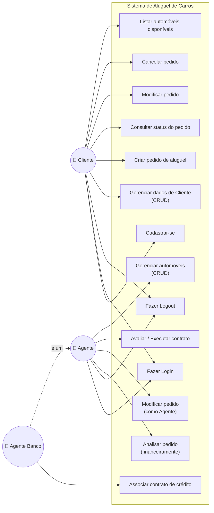
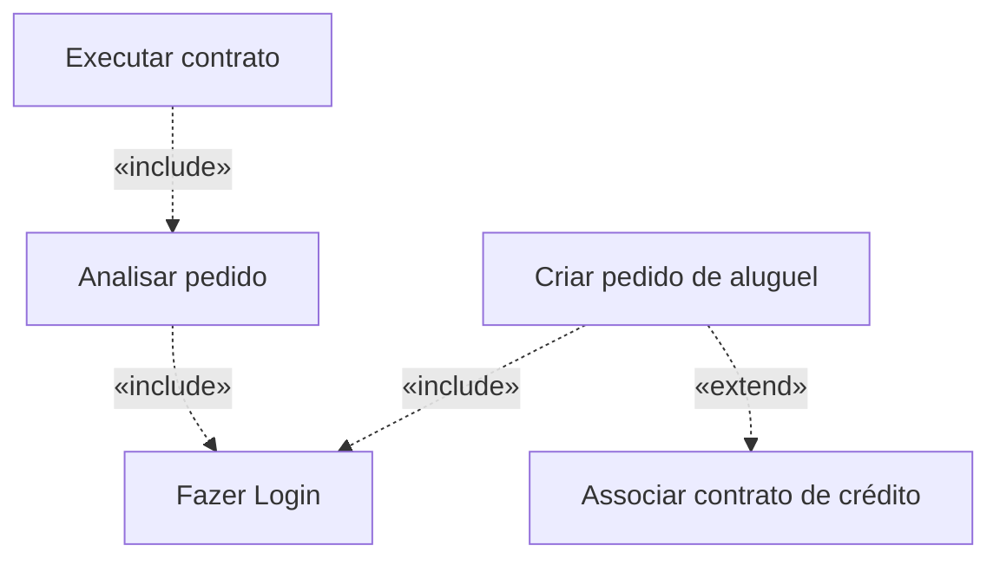

# Diagrama de Casos de Uso — Sistema de Aluguel de Carros

Representa os atores do sistema e suas interações com os casos de uso.
O diagrama é escrito em **Mermaid**, que o GitHub renderiza automaticamente.

## Atores
- **Cliente** — usuário individual que gerencia seus pedidos de aluguel.
- **Agente** — empresas e bancos que avaliam, modificam e executam pedidos.
- **Agente Banco** — Agente com `tipo = BANCO`, especializado na concessão de crédito (especialização no diagrama; no modelo de classes é o atributo `TipoAgente`).

## Diagrama

## Relações de dependência (`<<include>>` / `<<extend>>`)

## Descrição resumida dos casos de uso

| ID | Caso de Uso | Ator principal | Pré-condição |
| :-- | :--- | :--- | :--- |
| UC01 | Cadastrar-se | Cliente | — (Agentes são pré-cadastrados) |
| UC02 | Fazer Login | Todos | Estar cadastrado |
| UC03 | Fazer Logout | Todos | Estar autenticado |
| UC04 | Gerenciar dados de Cliente | Cliente | Autenticado |
| UC05 | Criar pedido de aluguel | Cliente | Autenticado, automóvel disponível |
| UC06 | Consultar status do pedido | Cliente | Autenticado, possuir pedido |
| UC07 | Modificar pedido | Cliente | Pedido em PENDENTE/EM_ANALISE |
| UC08 | Cancelar pedido | Cliente | Pedido não executado |
| UC09 | Analisar pedido | Agente | Pedido PENDENTE |
| UC10 | Avaliar / Executar contrato | Agente | Pedido APROVADO |
| UC11 | Associar contrato de crédito | Agente Banco | Pedido em análise/aprovado |
| UC12 | Gerenciar automóveis | Agente | Autenticado |
| UC13 | Listar automóveis disponíveis | Cliente | Autenticado |
| UC14 | Modificar pedido (como Agente) | Agente | Autenticado, pedido não executado |
