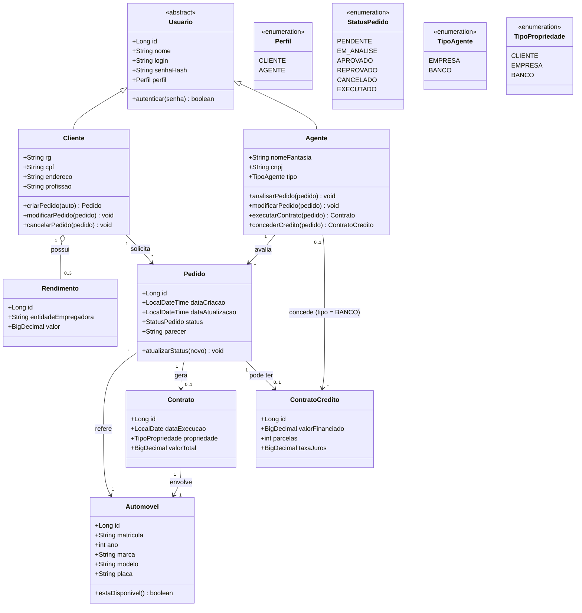

# Diagrama de Classes — Sistema de Aluguel de Carros

Modelo de domínio do sistema, representando entidades, atributos, métodos e relacionamentos.
Escrito em **Mermaid** (`classDiagram`). Fiel ao enunciado do Laboratório 02 (DIAW).

## Diagrama

## Descrição das entidades

| Entidade | Responsabilidade |
| :--- | :--- |
| **Usuario** (abstrata) | Classe base com dados de autenticação comuns a Cliente e Agente. |
| **Cliente** | Contratante do aluguel. Guarda RG, CPF, nome, endereço, profissão e até 3 rendimentos. |
| **Agente** | Empresa ou banco que avalia, modifica e executa pedidos. Quando `tipo = BANCO`, também concede crédito. |
| **Rendimento** | Entidade empregadora e valor auferido pelo cliente (máx. 3 por cliente). |
| **Automovel** | Veículo (matrícula, ano, marca, modelo, placa). A disponibilidade é derivada. |
| **Pedido** | Solicitação de aluguel feita pelo cliente, com ciclo de status. |
| **Contrato** | Formaliza a execução do aluguel e define a propriedade do automóvel. |
| **ContratoCredito** | Financiamento concedido por um agente do tipo banco, associado ao pedido. |

## Regras de negócio refletidas no modelo
- Um **Cliente** possui no máximo **3 Rendimentos** (`0..3`).
- Um **Pedido** sempre referencia **1 Automóvel** e pertence a **1 Cliente**.
- Um **Pedido** pode (opcionalmente) ter **1 ContratoCredito** e gerar **1 Contrato** ao ser executado.
- A **propriedade** do automóvel no contrato pode ser do cliente, empresa ou banco.
- Apenas **Agentes** avaliam e modificam pedidos; apenas Agentes com `tipo = BANCO` concedem crédito.
- Um automóvel está **disponível** quando não há `Contrato` executado para ele (ver decisões abaixo).

## Decisões de modelagem (revisão)

| # | Ponto | Decisão | Justificativa |
| :-- | :--- | :--- | :--- |
| 1 | `Banco` herdando de `Agente` + enum `TipoAgente` | **Removida a classe `Banco`**; mantido `TipoAgente` (EMPRESA, BANCO). | Redundância. O enunciado fala em "agentes (empresas e bancos)", ou seja, um único conceito com dois tipos. |
| 2 | Perfil Administrador | **Removido.** | Não consta no enunciado, que prevê apenas clientes e agentes. |
| 3 | `Automovel.disponivel` | **Atributo removido**; vira `estaDisponivel()` derivado. | Evita inconsistência com os contratos executados. Disponível = sem contrato executado. |
| 4 | `TipoPropriedade` vs `Perfil` | Papéis distintos. `Perfil` define o acesso ao sistema; `TipoPropriedade` define **quem é dono do automóvel** no contrato. | O enunciado: "automóveis alugados podem ser registrados como propriedade dos clientes, empresas ou bancos". |
| 5 | `ContratoCredito` ligado a `Pedido` ou `Contrato` | Ligado ao **`Pedido`**. | "O aluguel de um automóvel pode estar associado a um contrato de crédito". O crédito pode existir antes da execução do contrato. |
| 6 | `matricula` e `placa` | **Mantidos os dois.** | O enunciado lista ambos separadamente. |
| 7 | Parecer da análise | Adicionado `Pedido.parecer`. | O enunciado prevê "parecer positivo" da análise financeira. |
| 8 | Agente modifica pedido | Adicionado `Agente.modificarPedido`. | O enunciado diz que agentes "podem modificar e avaliar pedidos". |
| 9 | Cadastro de Agente | O cadastro público cria apenas **Cliente**. Agentes são **pré-cadastrados** (carga inicial no banco). | Evita que qualquer pessoa se declare Agente. Sem Administrador no escopo, a carga inicial resolve. |
| 10 | Logout com JWT | **Stateless**: o front descarta o token; o token tem expiração curta. | Sem blacklist, para manter o escopo simples. |
