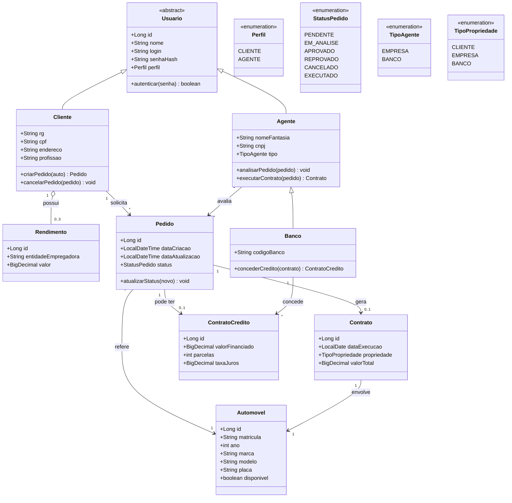

# Diagrama de Classes — Sistema de Aluguel de Carros

Modelo de domínio do sistema, representando entidades, atributos, métodos e relacionamentos.
Escrito em **Mermaid** (`classDiagram`).

## Diagrama

## Descrição das entidades

| Entidade | Responsabilidade |
| :--- | :--- |
| **Usuario** (abstrata) | Classe base com dados de autenticação comuns a Cliente e Agente. |
| **Cliente** | Contratante do aluguel. Guarda RG, CPF, endereço, profissão e até 3 rendimentos. |
| **Agente** | Empresa ou banco que avalia e executa pedidos. |
| **Banco** | Agente especializado que concede contratos de crédito. |
| **Rendimento** | Entidade empregadora e valor auferido pelo cliente (máx. 3 por cliente). |
| **Automovel** | Veículo disponível para aluguel (matrícula, ano, marca, modelo, placa). |
| **Pedido** | Solicitação de aluguel feita pelo cliente, com ciclo de status. |
| **Contrato** | Formaliza a execução do aluguel e define a propriedade do automóvel. |
| **ContratoCredito** | Financiamento concedido por um banco, associado a um pedido/contrato. |

## Regras de negócio refletidas no modelo
- Um **Cliente** possui no máximo **3 Rendimentos** (`0..3`).
- Um **Pedido** sempre referencia **1 Automóvel** e pertence a **1 Cliente**.
- Um **Pedido** pode (opcionalmente) ter **1 ContratoCredito** e gerar **1 Contrato** ao ser executado.
- A **propriedade** do automóvel no contrato pode ser do cliente, empresa ou banco.
- Apenas **Agentes** avaliam pedidos; apenas **Bancos** concedem crédito.
