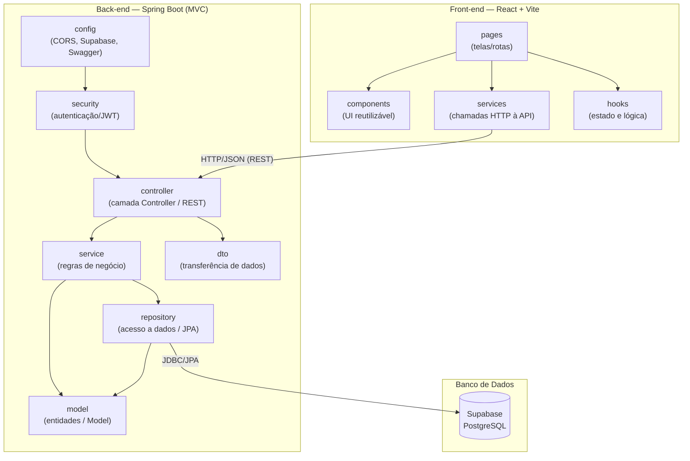
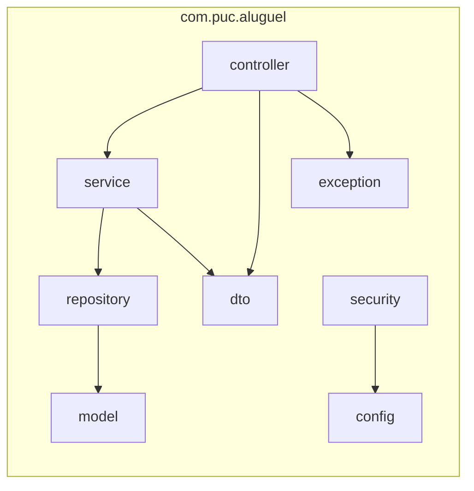

# Diagrama de Pacotes (Visão Lógica) — Sistema de Aluguel de Carros

Organização lógica do sistema em pacotes/camadas, seguindo a arquitetura **MVC** no
back-end (Spring Boot) e a separação de responsabilidades no front-end (React + Vite).
Escrito em **Mermaid**.

## Visão geral (Back-end + Front-end + Banco)

## Detalhe das camadas do Back-end (MVC)

## Responsabilidade de cada pacote (Back-end)

| Pacote | Camada MVC | Responsabilidade |
| :--- | :--- | :--- |
| `controller` | **Controller** | Expõe endpoints REST, recebe requisições e devolve respostas. |
| `service` | — (Service Layer) | Concentra as regras de negócio e orquestra repositórios. |
| `repository` | — (DAO) | Persistência via Spring Data JPA sobre o PostgreSQL (Supabase). |
| `model` | **Model** | Entidades de domínio mapeadas com JPA (`@Entity`). |
| `dto` | — | Objetos de transferência entre API e cliente, desacoplando o Model. |
| `security` | — | Autenticação/autorização (Spring Security + JWT). |
| `config` | — | Configurações de CORS, conexão Supabase, Swagger/OpenAPI. |
| `exception` | — | Tratamento global de erros e exceções customizadas. |

## Responsabilidade de cada pasta (Front-end)

| Pasta | Responsabilidade |
| :--- | :--- |
| `pages` | Telas e rotas da aplicação (Login, Clientes, Pedidos). |
| `components` | Componentes de UI reutilizáveis (formulários, tabelas, botões). |
| `services` | Camada de comunicação HTTP com a API Spring Boot. |
| `hooks` | Hooks personalizados para estado e lógica de autenticação. |

## Observações sobre a arquitetura
- O fluxo segue o padrão **MVC**: o `controller` recebe a requisição, delega ao `service`
  (regras de negócio), que usa o `repository` para persistir/consultar as entidades (`model`).
- Os **DTOs** evitam expor diretamente as entidades JPA na API.
- A autenticação é centralizada no pacote `security`, protegendo os endpoints.
- O front-end é desacoplado e se comunica exclusivamente via **API REST**.
